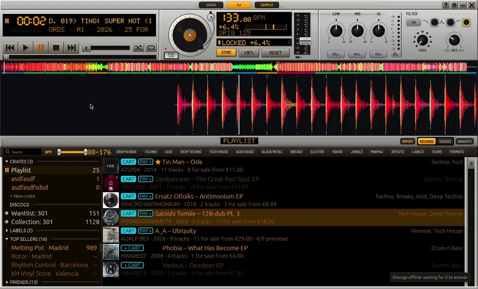
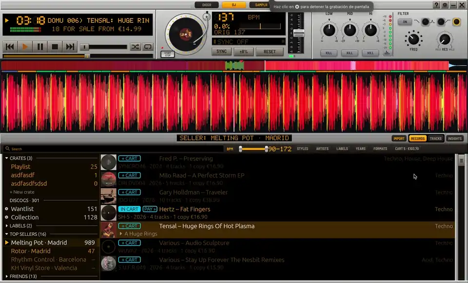
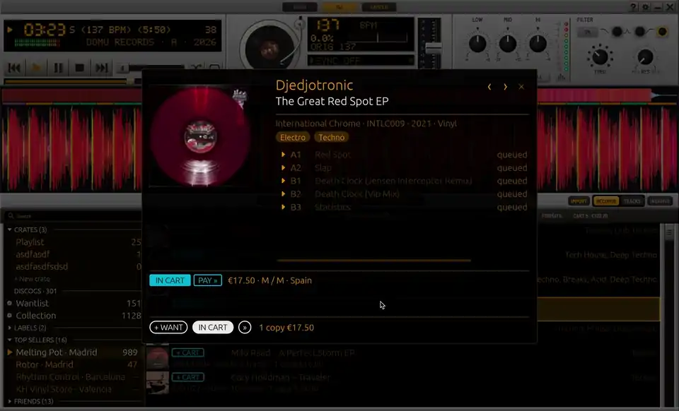
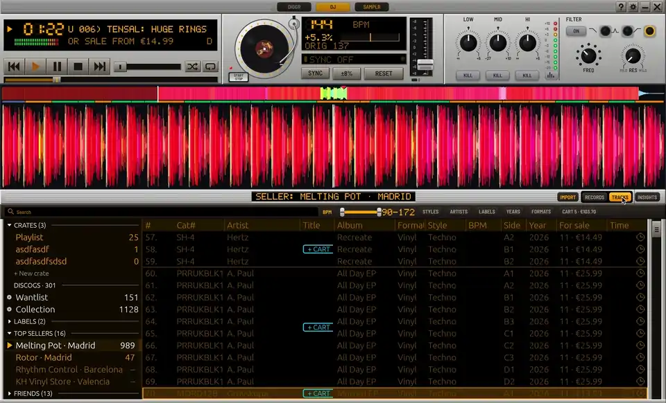
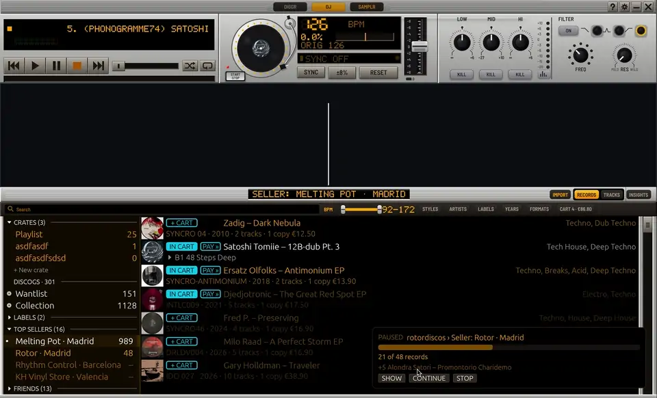
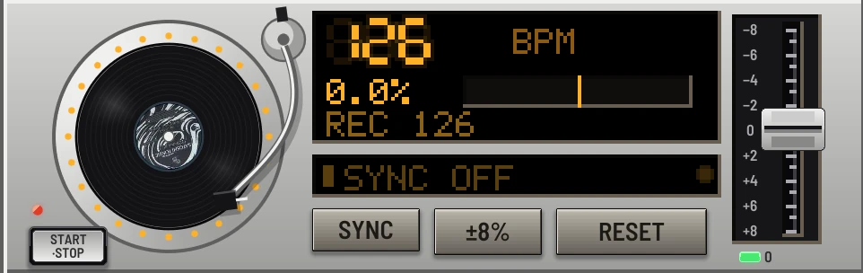
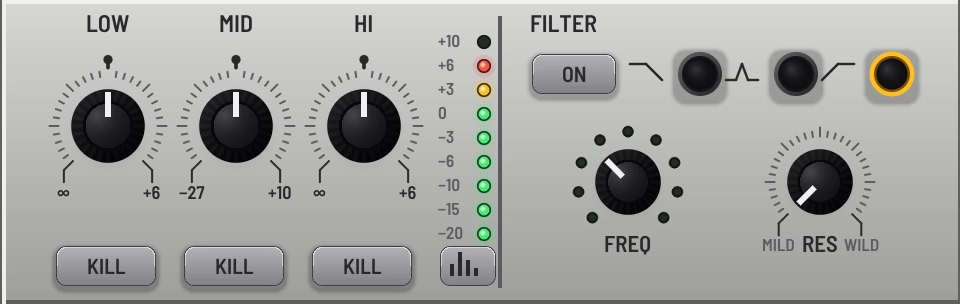
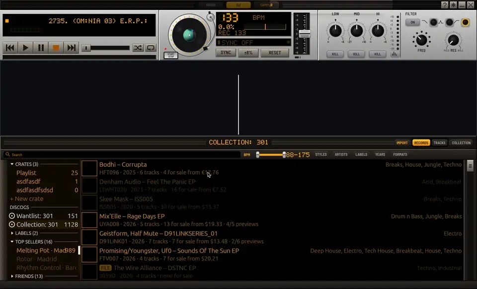

# Diggr

**Hear every record before you buy it.**

A free app for the listening part of buying records, for DJs and vinyl collectors.
Paste a page from Discogs, Bandcamp or your favourite store, hear every record on it, decide with one key, and buy later on the store.

**Free · No account · No ads · Mac, Windows, Linux**

[**⬇️ Download**](https://diggr.es/download-diggr/) · [**🌐 diggr.es**](https://diggr.es) · [How to](https://diggr.es/how-to/) · [FAQ](https://diggr.es/faq/)

---

This repository hosts the **installers of [Diggr](https://diggr.es)**. Every version is on the [Releases page](https://github.com/TOAST3R/diggr-release/releases).

## Download

| System | Download | Needs |
|---|---|---|
| **Mac** | [Diggr for Mac (.dmg)](https://diggr.es/download/mac) | macOS 11 or later, Apple Silicon or Intel |
| **Windows** | [Diggr for Windows (.zip)](https://diggr.es/download/windows) | Windows 10 or 11, 64-bit (no ARM build) |
| **Linux** | [Diggr for Linux (.tar.gz)](https://diggr.es/download/linux) | x86_64, glibc 2.31 or later (Debian 11, Ubuntu 20.04, Fedora 32 and newer) |

Each release also has a `SHA256SUMS` file to check your download against.

### First time you open it

Diggr isn't code-signed, so your system asks once:

- **Mac:** open the DMG and drag Diggr to Applications. The first time, open **System Settings ▸ Privacy & Security** and click **Open Anyway** next to Diggr.
- **Windows:** extract the zip and open `Diggr.exe` (nothing to install, no admin rights). When Windows asks, click **More info**, then **Run anyway**.
- **Linux:** extract it and run `./install.sh` to add Diggr to your applications menu, or just `./diggr`. No root needed.

**Previews set themselves up.** Records with no store clip play through [yt-dlp](https://github.com/yt-dlp/yt-dlp). The first time, Diggr offers to install it from yt-dlp's official releases and checks its SHA-256 before it runs. If you already have yt-dlp, Diggr uses yours. Your own files play without it.

## What it does

### Paste a link, hear every record
Copy a Discogs page (label, artist, release, seller, wantlist, collection) or a Bandcamp one and press **Cmd+V** (Ctrl+V). Every record on the page lands in a crate, grouped by record, with covers, styles, catalogue numbers and copies for sale, and plays as one gapless playlist.

### One key per record
`Y` adds the record to your Discogs wantlist, `N` passes, **+ CART** puts a copy in your real Discogs, Juno or Bleep basket. You always pay on the store.

### Every track with its BPM
Switch the crate to tracks: catalogue number, artist, format, style, BPM, side, year and copies for sale. Filter by BPM, style, label, year and format.

### Sellers and your local record store
Open any Discogs seller's whole stock as a crate. Connect Discogs and your top sellers get crates of their own, including the [Spanish record stores](https://diggr.es/stores/) that sell on Discogs.

### Mixes become tracklists
Paste a SoundCloud or YouTube mix and its tracklist becomes a crate in mix order. Every identified track plays, and **+ CART** takes you to the store that sells it.

### DJ mode and Sampler
Press `J` for the turntable: **SYNC** plays every track at your set's tempo, with a ±8% or ±16% pitch fader, three-band EQ and a filter. Camelot keys show for Beatport and Traxsource tracks. Press `M` for the Sampler: loop a bar, snap A and B to the beat, and **EXPORT WAV** saves a 24-bit loop for your DAW.

 

### Your Discogs account
Not needed to listen. Click **Connect with Discogs**, then **Authorize** (no token to copy): `Y` syncs your wantlist both ways, records you own are marked **OWNED** in any pressing, and your collection opens in **Insights** with records per year, styles, top labels and artists, and what it's worth.

### More stores with the Chrome extension
The free [Diggr bridge extension](https://chromewebstore.google.com/detail/diggr-bridge/cineoflmmlmgdkefaegeocjgelnijfkk) adds a ▶ Diggr button to Discogs, Bandcamp, Juno, Beatport, Traxsource, Bleep, SoundCloud and YouTube, and is how Juno, Beatport, Traxsource and Bleep pages come into Diggr. It talks only to the player on your computer, paired with a 6-digit code.

### Your own music too
Drag files or folders onto the window: MP3, FLAC, WAV, OGG, M4A and AAC, with the same gapless engine, analysis and crates.

## Feedback

Found a bug or missing a store? [Open an issue](https://github.com/TOAST3R/diggr-release/issues) or write to **hola@diggr.es**.

---

Made for the crate diggers 🎧 **[diggr.es](https://diggr.es)**

