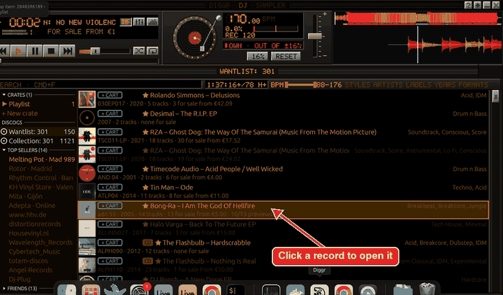
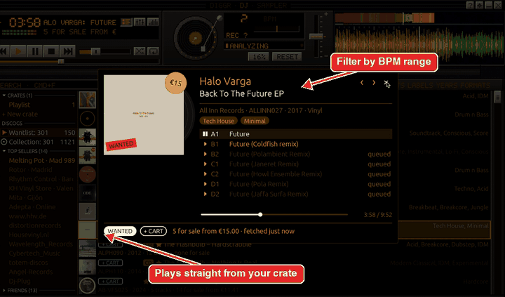
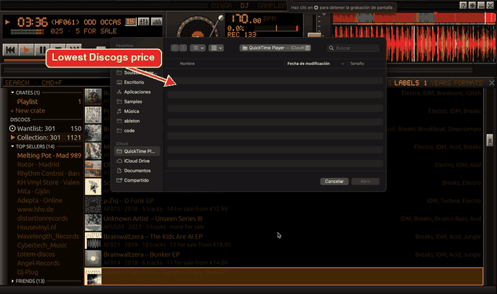
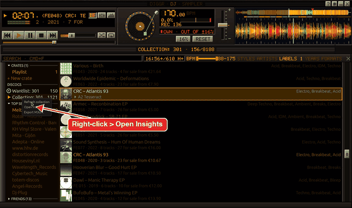
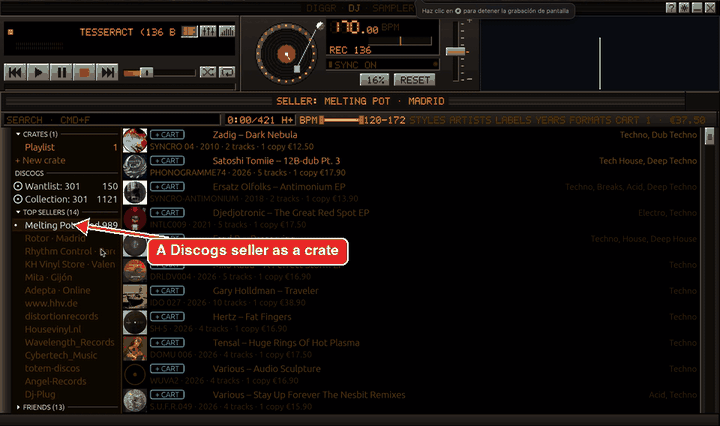
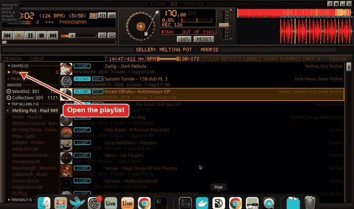
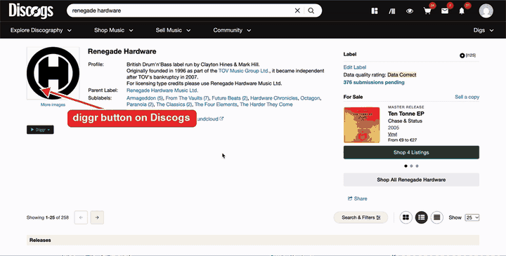
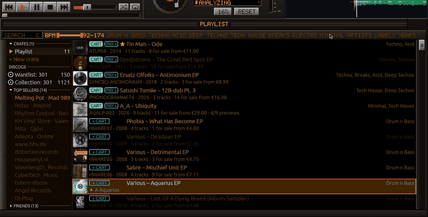
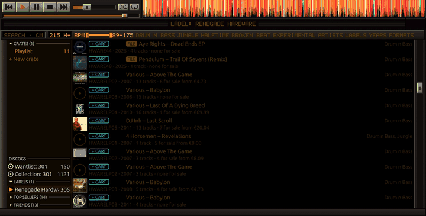

# Diggr

**Preview tunes. Dig deeper. Buy better.**

The desktop app for record diggers: play through Discogs releases, crates and sellers' stock without leaving the player.

[**🌐 diggr.es**](https://diggr.es) · [**⬇️ Download the latest release**](https://github.com/TOAST3R/diggr-release/releases/latest)

---

This repository hosts the **releases of [Diggr](https://diggr.es)**. Installers for every version are on the [Releases page](https://github.com/TOAST3R/diggr-release/releases).

Diggr connects to your Discogs account and turns your wantlist, collection, favourite sellers and labels into crates you can listen to straight away. You can preview tracks, filter by BPM and style, check prices and fill your cart, all from one window.

## Download

1. Go to the [latest release](https://github.com/TOAST3R/diggr-release/releases/latest).
2. Download the installer for your system.
3. Open Diggr and connect your Discogs account.

## Features

### Preview any record instantly
Click a record to open its release panel. You can play any track, add it to your wantlist or put a copy in your cart.

### Crates that play
Your wantlist and collection play straight from the crate. Filter by BPM range, and clips load in the background while you dig.

### Filter, queue and compare prices
Filter by styles, artists, labels, years and formats. Queue up tracks and see the lowest Discogs price for each release.

### Insights
Right-click your collection and choose **Open Insights** to see a breakdown by style, label and more, plus what your collection is worth.

### Sellers as crates
Open any Discogs seller's stock as a crate. Listen through it and add the copies you want to your cart as you go.

### Playlist
Collect tracks in your playlist. BPM is detected automatically when each track loads.

### Play from Discogs
A **Diggr** button appears on Discogs pages. Click it on any release and the record is queued straight into Diggr.

### Labels
Send a whole label to Diggr from its Discogs page. Its tracklists stream in so you can dig through the full catalogue.

### Sampler
Set loop points A/B, fine-tune them, and snap to the beat or bar. Audition the loop, then export it as a WAV.

---

Made for diggers 🎧 **[diggr.es](https://diggr.es)**

